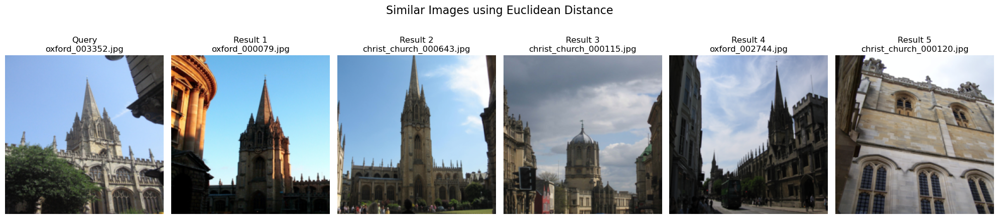

# ResNet-Based Image Retrieval

This project was developed as an exercise for the **Introduction to Information Retrieval** course in **Spring 2024 at BuAli Sina University**.

The mini project explores content-based image retrieval using pretrained ResNet-50 features and different distance metrics. Images from the Oxford Buildings dataset are represented as feature vectors, and visually similar images are retrieved using Euclidean, cosine, and Manhattan distances. Multidimensional scaling (MDS) is also used to visualize relationships between images.

## Table of Contents

- [Overview](#overview)
- [Methodology](#methodology)
- [Project Structure](#project-structure)
- [Dataset](#dataset)
- [Installation](#installation)
- [Usage](#usage)
- [Limitations](#limitations)
- [Possible Improvements](#possible-improvements)
- [Technologies](#technologies)
- [Acknowledgments](#acknowledgments)

## Overview

The goal of this project is to explore how image features extracted by a pretrained deep neural network can be used for similarity-based image retrieval.

Instead of comparing raw pixel values, each image is represented by a feature vector extracted from ResNet-50. Pairwise distances between these feature vectors are then used to retrieve images most similar to a given query image.

The experiment includes:

- Feature extraction using pretrained ResNet-50.
- Similarity comparison using three distance metrics.
- Nearest-neighbor image retrieval.
- Two-dimensional visualization of image distances using MDS.
- Visual comparison of retrieval results across distance metrics.

## Methodology

### 1. Image Preprocessing

Images are resized to 224 × 224 pixels and normalized using the standard ImageNet mean and standard deviation expected by the pretrained ResNet-50 model.

### 2. Feature Extraction

A pretrained ResNet-50 model is used as a feature extractor. Its final classification layer is removed, and the resulting 2048-dimensional feature vector is used to represent each image.

The model is used in evaluation mode without additional training or fine-tuning.

### 3. Distance Metrics

The feature vectors are compared using three distance metrics:

| Metric | Description |
|---|---|
| Euclidean distance | Measures the straight-line distance between feature vectors. |
| Cosine distance | Measures the difference in direction between feature vectors. |
| Manhattan distance | Measures the sum of absolute differences between feature-vector components. |

For each metric, a pairwise distance matrix is calculated. The nearest images to a query are selected by sorting their distances, excluding the query image itself.

### 4. Multidimensional Scaling

Multidimensional scaling (MDS) is applied separately to each distance matrix to project the image relationships into two dimensions.

The resulting scatter plots provide an exploratory visualization of the image collection under each metric.

### 5. Image Retrieval Results

Several query images are selected, and their nearest neighbors are displayed for each distance metric. This allows visual comparison of the retrieved images and how the results change with the choice of metric.

The following figure shows an example of image retrieval using Euclidean distance.



The visualization is intended to illustrate the structure of the feature space rather than serve as a quantitative measure of retrieval performance.

## Project Structure

```text
resnet-image-retrieval/
├── README.md
├── image_retrieval.ipynb
├── figures/
│   └── euc.png
└── oxbuilding/
    └── ...
```

The `oxbuilding/` directory contains the dataset images and does not need to be committed to the repository. The notebook filename can be adjusted to match the actual file in the project.

## Dataset

This project uses images from the Oxford Buildings dataset, a collection of images of Oxford landmarks used in visual recognition and retrieval research.

Dataset website: https://www.robots.ox.ac.uk/~vgg/data/oxbuildings/

Download and extract the images, then place them in the `oxbuilding/` directory relative to the notebook, or update the dataset path in the code.

The experiment uses a randomly sampled subset of up to 200 images. A fixed random seed is used to make the sampling reproducible when the dataset contents and execution environment remain unchanged.

## Installation

Python 3.9 or later is recommended.

Install the required libraries:

```bash
pip install numpy matplotlib torch torchvision pillow scikit-learn jupyter
```

For GPU acceleration, install the PyTorch version compatible with your hardware by following the official instructions:

https://pytorch.org/get-started/locally/

## Usage

1. Download and extract the Oxford Buildings images.
2. Place the images in the `oxbuilding/` directory.
3. Install the required dependencies.
4. Open `image_retrieval.ipynb` in Jupyter Notebook or JupyterLab.
5. Run the cells in order.

The notebook extracts image features, calculates the distance matrices, generates MDS visualizations, and displays retrieved images for selected queries.

The pretrained ResNet-50 weights must be available locally or downloaded through Torchvision before running the feature-extraction cell.

## Limitations

- The experiment uses a limited subset of the dataset rather than the full collection.
- ResNet-50 is used as a pretrained feature extractor without task-specific fine-tuning.
- Retrieval quality is inspected visually; formal retrieval metrics such as Precision@k or mean Average Precision (mAP) are not evaluated.
- MDS provides a two-dimensional approximation of the distance relationships and may not preserve all relationships in the original feature space.
- Pairwise distance calculations may become inefficient for much larger image collections.

## Possible Improvements

- Evaluate retrieval quality using relevance labels and metrics such as Precision@k or mAP.
- Compare different pretrained feature extractors or intermediate network representations.
- Explore feature normalization and alternative similarity measures.
- Extend the experiment to larger image collections and more efficient nearest-neighbor search.
- Build a simple interface that accepts a query image and displays its nearest matches.

## Technologies

- Python
- PyTorch and Torchvision
- ResNet-50
- NumPy
- Matplotlib
- Scikit-learn
- Pillow

## Acknowledgments

This exercise was completed for the Introduction to Information Retrieval course at BuAli Sina University in Spring 2024.

The project uses the Oxford Buildings dataset and pretrained ResNet-50 weights provided through Torchvision.