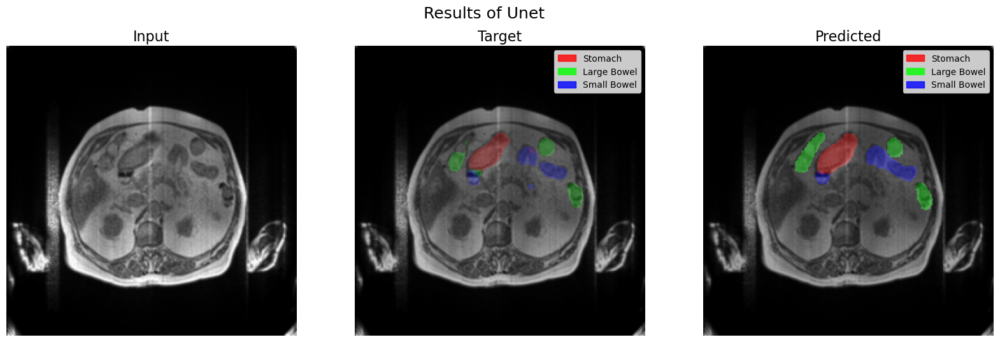
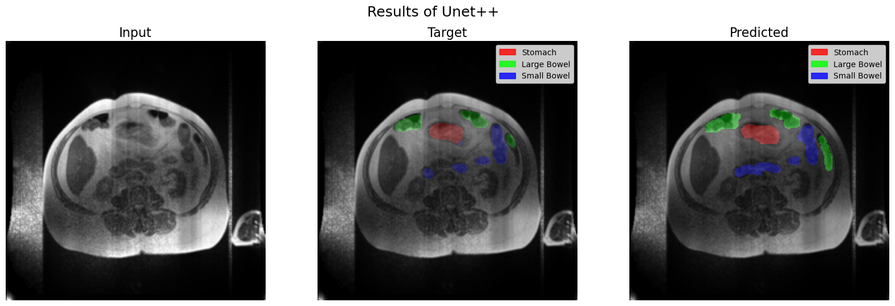
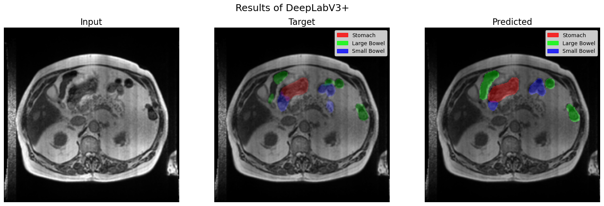
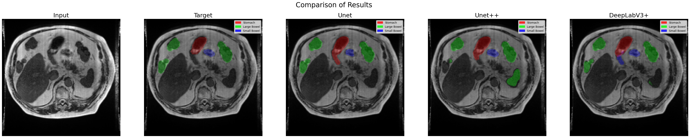
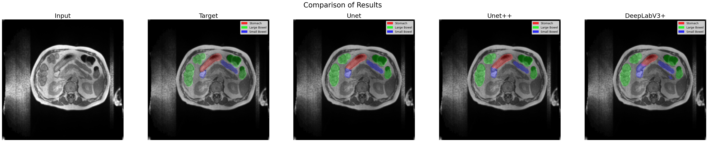
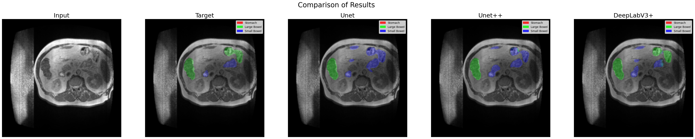
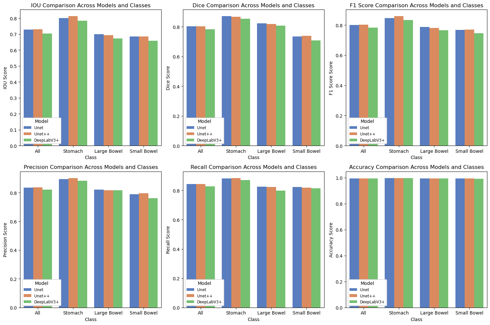

# Medical Image Segmentation: U-Net, U-Net++, and DeepLabV3+

A medical image segmentation project developed in Spring 2024 as a prelude to my original BSc project at BuAli Sina University. The project explores and compares three deep learning architectures for segmenting gastrointestinal organs in MRI scans.

## Table of Contents

- [Overview](#overview)
- [Visual Overview](#visual-overview)
- [Project Structure](#project-structure)
- [Dataset](#dataset)
- [Model Architecture](#model-architecture)
- [Installation](#installation)
- [Usage](#usage)
- [Results](#results)
- [Limitations and Future Work](#limitations-and-future-work)

## Overview

The goal of this project is to perform **multi-class semantic segmentation** of three organs in gastrointestinal MRI images:

- **Stomach**
- **Large Bowel**
- **Small Bowel**

Three segmentation models were implemented using PyTorch and compared on a held-out test set. The workflow includes data preprocessing, exploratory data analysis, model training, evaluation, and visualization of predictions.

## Visual Overview

### Segmentation Examples

Each image compares a model's segmentation output with the original mask.

**U-Net**



**U-Net++**



**DeepLabV3+**



### Model Prediction Comparisons

**Comparison 1**



**Comparison 2**



**Comparison 3**



### Metrics Comparison




Additional visual comparisons are available in `Evaluation.ipynb`.

## Project Structure

```text
.
├── data/                       # Dataset files (not tracked)
├── figures/                    # Visualization and comparison figures
├── models/                     # Saved model weights
├── models_data/                # Training histories (not tracked)
├── results/                    # Evaluation outputs (not tracked)
├── splits/                     # Train/validation/test split definitions
├── splits_data/                # Processed split data (not tracked)
├── Preprocess & EDA.ipynb      # Preprocessing and exploratory analysis
├── Model.ipynb                 # Model training and experiments
├── Evaluation.ipynb            # Test evaluation and visualization
└── .gitignore
```

Generated files, datasets, and model checkpoints are excluded from version control. Their directories may need to be created locally.

## Dataset

This project uses the [UW-Madison GI Tract Image Segmentation dataset](https://www.kaggle.com/competitions/uw-madison-gi-tract-image-segmentation) from the Kaggle competition.

The dataset contains MRI image slices and segmentation annotations encoded as run-length encoding (RLE).

The preprocessing workflow includes:

- Removing missing and duplicate records.
- Extracting image metadata and constructing image paths.
- Decoding RLE annotations into segmentation masks.
- Preparing separate masks for the three target organs.
- Creating training, validation, and test datasets based on case-level splits.

**Note:** The dataset is not included in this repository. Download it from Kaggle and configure the local paths and split files before running the notebooks.

## Model Architecture

All three models use a **ResNet34 encoder** and produce three output channels corresponding to the target organs.

| Model | Description |
|---|---|
| U-Net | Encoder-decoder architecture with skip connections. |
| U-Net++ | Nested skip connections designed to improve feature fusion. |
| DeepLabV3+ | Encoder-decoder architecture incorporating atrous spatial pyramid pooling. |

**Training configuration:**

- Framework: PyTorch
- Input resolution: 224 × 224 pixels
- Input images: Grayscale
- Output classes: Stomach, Large Bowel, Small Bowel
- Loss function: Dice Loss for multilabel segmentation
- Optimizer: Adam
- Data augmentation: Random horizontal and vertical flips
- Normalization: Min-max scaling followed by normalization using mean and standard deviation of 0.5
- Training duration: 16 epochs per model, across training stages

## Installation

Python 3.10 or a compatible environment is recommended. The project was developed with the following library versions:

```text
numpy                         1.26.4
pandas                        2.2.2
matplotlib                    3.8.4
seaborn                       0.13.2
opencv-python                 4.9.0.80
scikit-learn                  1.9.0
torch                         2.2.1+cu118
torchvision                   0.17.1+cu118
segmentation-models-pytorch   0.3.2
torchmetrics                  1.4.0.post0
```

Create and activate a virtual environment, then install the dependencies:

```bash
python -m venv .venv
```

Activate it:

```bash
# Linux / macOS
source .venv/bin/activate

# Windows
.venv\Scripts\activate
```

Install the PyTorch and torchvision versions compatible with CUDA 11.8 using the [official PyTorch installation instructions](https://pytorch.org/get-started/previous-versions/). Then install the remaining libraries:

```bash
pip install numpy==1.26.4 pandas==2.2.2 matplotlib==3.8.4 seaborn==0.13.2 opencv-python==4.9.0.80 scikit-learn==1.9.0 segmentation-models-pytorch==0.3.2 torchmetrics==1.4.0.post0
```

Finally, install Jupyter Notebook if needed:

```bash
pip install notebook
```

A CUDA-capable GPU is recommended for training, although CPU execution may be possible with longer runtimes.

## Usage

Run the notebooks in the following order:

1. **`Preprocess & EDA.ipynb`** — Explore the dataset, decode masks, and prepare the data splits.
2. **`Model.ipynb`** — Train U-Net, U-Net++, and DeepLabV3+ and save model checkpoints and training histories.
3. **`Evaluation.ipynb`** — Load trained checkpoints, evaluate the test set, and generate comparison plots and metric tables.

Before running the notebooks, ensure the dataset paths and split files are configured correctly. Evaluation requires the trained model checkpoints, which are not included in the repository.

## Results

The following results summarize the reported test-set metrics. Values are rounded to four decimal places.

### Overall performance

| Metric | U-Net | U-Net++ | DeepLabV3+ |
|---|---:|---:|---:|
| IoU | 0.7280 | **0.7303** | 0.7045 |
| Dice | **0.8032** | 0.8023 | 0.7827 |
| F1 Score | 0.8014 | **0.8032** | 0.7820 |
| Precision | 0.8349 | **0.8382** | 0.8204 |
| Recall | **0.8430** | 0.8425 | 0.8273 |
| Accuracy | 0.9950 | **0.9950** | 0.9945 |

### IoU by organ

| Organ | U-Net | U-Net++ | DeepLabV3+ |
|---|---:|---:|---:|
| Stomach | 0.8009 | **0.8127** | 0.7836 |
| Large Bowel | **0.6988** | 0.6922 | 0.6719 |
| Small Bowel | 0.6844 | **0.6860** | 0.6582 |

### Key observations

- **U-Net++** achieved the highest overall IoU and the strongest IoU for the stomach and small bowel.
- **U-Net** achieved the highest overall Dice score and performed best on the large bowel by IoU.
- **DeepLabV3+** achieved lower scores than the other two models across the reported overall metrics.
- Accuracy was high for all models, but IoU and Dice provide more informative measures of segmentation overlap when background pixels dominate an image.

The `figures/` directory contains visual comparisons of model predictions and plots of the evaluation metrics.

## Limitations and Future Work

- **Class imbalance:** Further experiments with class-weighted losses or alternative segmentation losses could improve results for difficult regions.
- **Hyperparameter tuning:** A more systematic tuning strategy and repeated experiments could improve the reliability of comparisons.
- **Data augmentation:** Additional augmentations could improve robustness.
- **Reproducibility:** Publishing fixed dependency files, split definitions, trained checkpoints, and random seeds would make the experiments easier to reproduce.
- **Evaluation:** Further analysis could include per-case results, confidence intervals, and additional segmentation metrics.

## Acknowledgments

Developed in Spring 2024 as a prelude to my original BSc project at **BuAli Sina University**. This project provided practical experience in medical image segmentation, PyTorch-based deep learning, encoder-decoder architectures, data preprocessing, and quantitative evaluation of segmentation performance.

- The [UW-Madison GI Tract Image Segmentation Kaggle competition](https://www.kaggle.com/competitions/uw-madison-gi-tract-image-segmentation) for providing the dataset.
- The developers of [PyTorch](https://pytorch.org/), [torchvision](https://pytorch.org/vision/), and [segmentation-models-pytorch](https://github.com/qubvel/segmentation_models.pytorch) for the tools used in this project.
